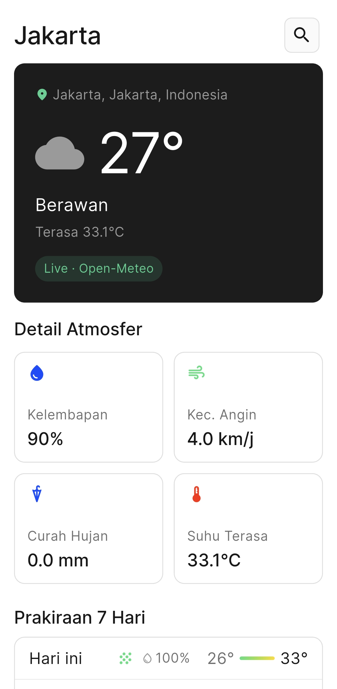

# WeatherApp: Aplikasi Prakiraan Cuaca

Aplikasi mobile Flutter untuk melihat prakiraan cuaca real-time berbasis **REST API Open-Meteo**, dibangun dengan pola arsitektur **MVVM**.

---

## Screenshot

| Home / Weather Screen | Search / Location Screen |
|---|---|
|  |  |

---

## Struktur Aplikasi

```
lib/
├── main.dart                    # Entry point, setup Provider & Hive
├── core/
│   ├── theme.dart               # ThemeData & token warna
│   └── weather_code_helper.dart # Terjemahan kode deskripsi & ikon
├── models/
│   ├── location_model.dart      # Model data lokasi (Geocoding API)
│   └── weather_model.dart       # Model data cuaca (Forecast API)
├── services/
│   ├── weather_service.dart     # HTTP GET ke Open-Meteo API
│   └── storage_service.dart     # Baca/tulis ke Hive
├── viewmodels/
│   ├── weather_viewmodel.dart   # State management untuk cuaca
│   └── search_viewmodel.dart    # State management untuk pencarian & favorit
└── views/
    ├── home_screen.dart         # Home / Weather Screen
    ├── search_screen.dart       # Search / Location Screen
    └── widgets/
        ├── metric_card.dart         # Kartu metrik atmosfer
        ├── daily_forecast_item.dart # Item baris prakiraan harian
        ├── error_state_widget.dart  # Widget kondisi error + retry
        └── empty_state_widget.dart  # Widget kondisi data kosong
```

---

## Implementasi Arsitektur MVVM

| Lapisan | File | Tanggung Jawab |
|---------|------|----------------|
| **Model** | `models/*.dart` | Struktur data Dart, parsing JSON, serialisasi |
| **Service** | `services/*.dart` | HTTP GET ke API, read/write Hive |
| **ViewModel** | `viewmodels/*.dart` | State reaktif (loading/empty/error/success), orkestrasi service |
| **View** | `views/*.dart` | Widget Flutter & UI Utama |

---

## Implementasi API Open-Meteo

### Geocoding API
```
GET https://geocoding-api.open-meteo.com/v1/search
    ?name=<kota>
    &count=10
    &language=id
    &format=json
```

### Weather Forecast API
```
GET https://api.open-meteo.com/v1/forecast
    ?latitude=<lat>
    &longitude=<lon>
    &current=temperature_2m,relative_humidity_2m,apparent_temperature,
             precipitation,weather_code,wind_speed_10m
    &daily=temperature_2m_max,temperature_2m_min,
           precipitation_probability_max,weather_code
    &timezone=auto
    &forecast_days=7
```

### Field yang Ditampilkan

| Field API | Tampil di UI |
|-----------|-------------|
| `current.temperature_2m` | Suhu saat ini (hero card) |
| `current.relative_humidity_2m` | Kartu Kelembapan |
| `current.apparent_temperature` | Kartu Suhu Terasa |
| `current.precipitation` | Kartu Curah Hujan |
| `current.weather_code` | Ikon & deskripsi kondisi |
| `current.wind_speed_10m` | Kartu Kecepatan Angin |
| `daily.temperature_2m_max` | Suhu maks baris prakiraan |
| `daily.temperature_2m_min` | Suhu min baris prakiraan |
| `daily.precipitation_probability_max` | % hujan baris prakiraan |

---
##  Cara Menjalankan

```bash
# Clone project
git clone https://github.com/kmuiii/weather-app-andorid.git
cd weatherapp

# Install dependencies
flutter pub get

# Jalankan di emulator/device
flutter run
```

> **Catatan**: Aplikasi membutuhkan koneksi internet untuk mengambil data cuaca dari Open-Meteo API.
